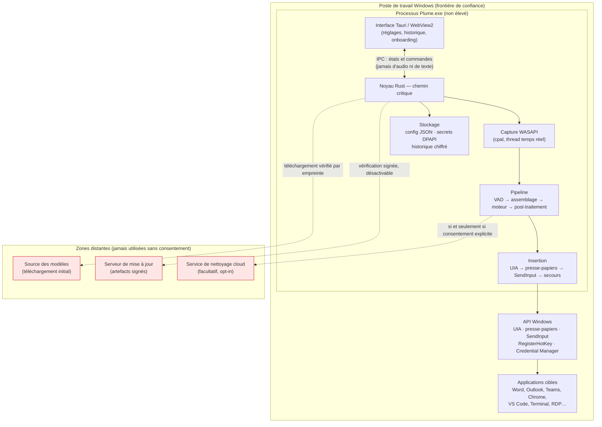
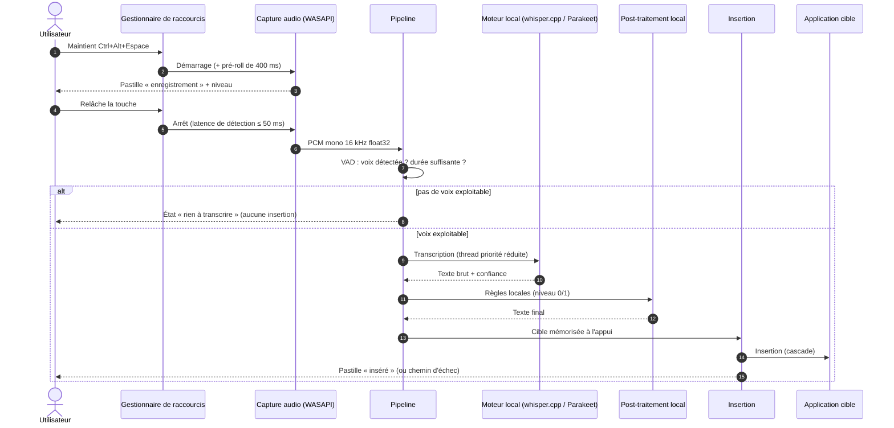
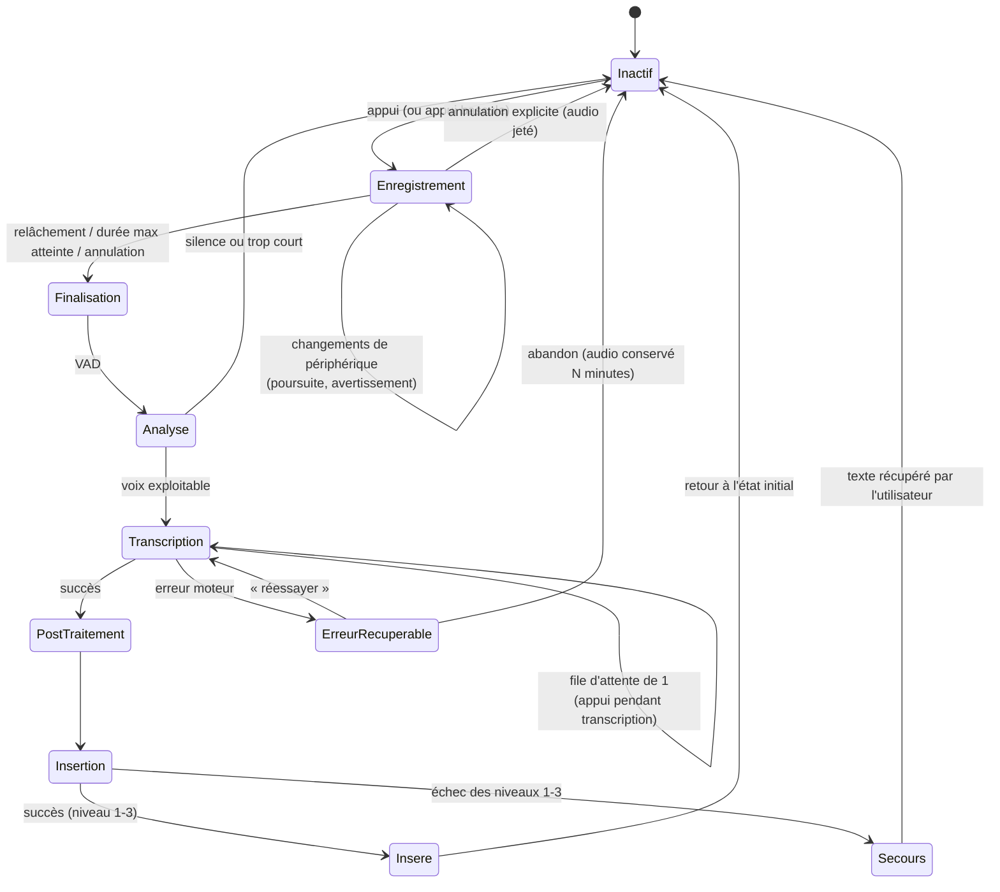
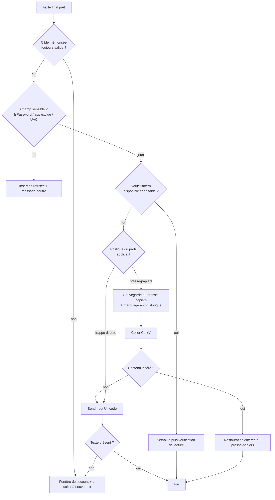
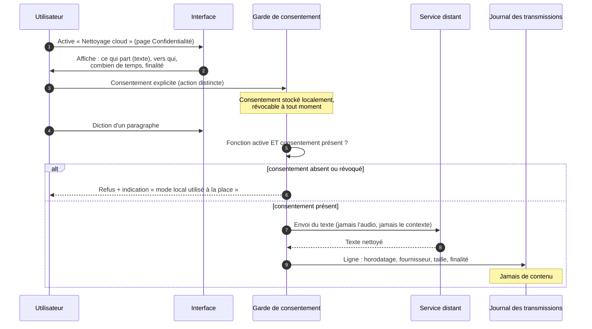
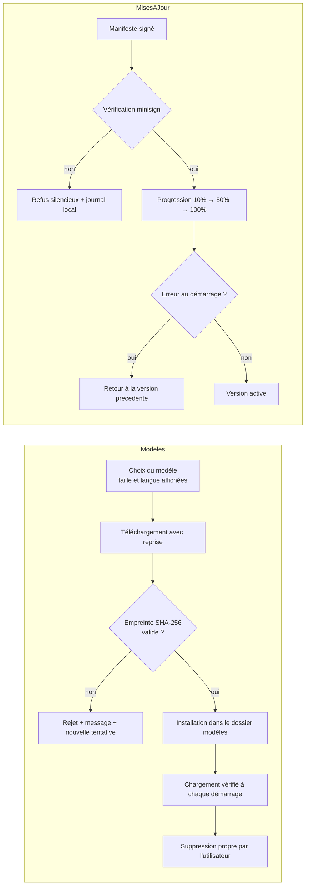

# Livrable 4 — Diagrammes et flux

Les diagrammes sont en syntaxe Mermaid (rendus par GitHub, VS Code et la plupart des visionneuses
Markdown). Ils décrivent le comportement **cible** ; l'écart avec le prototype P0 sera documenté
dans le journal de mesures.

---

## 1. Vue des composants et frontières de confiance

**Lecture** : le seul chemin traversant la frontière de confiance est en pointillés, à droite, et
chaque flèche correspond à un flux nommé, documenté et désactivable (RF-35).

---

## 2. Flux nominal : dictée locale complète

**Budget de latence cible (à mesurer, pas à promettre)** — pour un énoncé de 10 s :

| Étape | Cible p50 | Cible p95 | Comment c'est mesuré |
|---|---|---|---|
| Détection du relâchement | ≤ 60 ms | ≤ 120 ms | Horodatage interne (scrutation 50 ms) |
| Finalisation audio + VAD | 150 ms | 400 ms | Journal de pipeline |
| Inférence (moteur par défaut, CPU de milieu de gamme) | ≤ 800 ms | ≤ 1 800 ms | Mesure moteur (voir `docs/06`) |
| Post-traitement local (niveau 1) | ≤ 15 ms | ≤ 40 ms | Banc de test règles |
| Insertion (niveau 1 ou 2) | 60 ms | 500 ms | Journal d'insertion |
| **Total perçu** | **≤ 1,1 s** | **≤ 2,9 s** | Somme mesurée, machine de référence |

---

## 3. Machine à états de la session de dictée

**Invariants de la machine à états** (vérifiés par tests) :
1. Aucune transition ne peut perdre le texte transcrit (RF-20, RF-22).
2. Une seule session active à la fois ; une seconde demande est mise en file ou refusée explicitement
   (RF-05).
3. L'audio est libéré après insertion ou après expiration du délai de récupération.

---

## 4. Décision d'insertion (cascade)

**Règle de conception** : chaque niveau indique au suivant *pourquoi* il a échoué, et ce motif est
journalisé localement (sans contenu) afin de mesurer le taux de repli par application (hypothèse H3).

---

## 5. Flux distants : consentement et journalisation

---

## 6. Cycle de vie des modèles et des mises à jour

---

## 7. Table des défaillances et des reprises

| Défaillance | Détection | Comportement | Exigence |
|---|---|---|---|
| Micro débranché pendant la prise | Nombre de trames nul / événement de périphérique | Arrêt propre, message, audio déjà capté conservé | RF-10 |
| Micro occupé en mode exclusif | Échec d'ouverture WASAPI | Message explicite + aide (« une autre application utilise le micro ») | RF-08 |
| Silence total (raccourci oublié) | VAD | Aucune insertion, état « rien à transcrire » | RF-18 |
| Erreur du moteur (mémoire, modèle) | Retour d'erreur / panique capturée | Audio conservé, « réessayer », rechargement automatique | RF-20, RF-21 |
| Insertion refusée par la cible | Valeur non relue / pas de changement détecté | Passage au niveau suivant, puis fenêtre de secours | RF-28, RF-31 |
| Champ sensible | `IsPassword` ou liste d'exclusion | Refus, message neutre, aucune lecture | RF-29 |
| Fenêtre cible fermée | Identifiant de fenêtre invalide | Fenêtre de secours | RF-32 |
| Presse-papiers verrouillé par un tiers | Échec d'ouverture du presse-papiers | Réessais avec temporisation, puis niveau 3 | RF-30 |
| Copie utilisateur pendant le maintien | Comparaison du contenu | La copie de l'utilisateur est conservée | RF-30 |
| Fenêtre élevée au premier plan | Détection d'échec d'injection | Message pédagogique, aucun échec silencieux | ADR-06 |
| Réseau coupé avec fonction cloud active | Erreur réseau | Repli automatique en local, information de l'utilisateur | RF-36 |
| Panique du webview | Absence d'événement de vie | Le noyau continue ; le webview est relancé | ADR-02 |
| Disque plein pendant un téléchargement | Erreur d'écriture | Téléchargement interrompu proprement, reprise possible | RF-15 |

---

## 8. Ce qui sort de la machine : tableau de vérité

Ce tableau est la spécification de la page « Qu'est-ce qui sort de ma machine ? » (RF-35).

| Situation | Audio | Texte dicté | Contexte (app/titre/sélection) | Destinataire | Désactivable ? |
|---|---|---|---|---|---|
| Dictée en mode local strict | Non | Non | Non | — | — |
| Dictée + post-traitement cloud consenti | Non | **Oui** | Non | Fournisseur choisi par l'utilisateur | Oui, par dictée et globalement |
| Vérification de mise à jour | Non | Non | Non | Serveur de mise à jour | Oui |
| Téléchargement d'un modèle | Non | Non | Non | Source du modèle | Oui (installation manuelle possible) |
| Activation de licence (facultative) | Non | Non | Non (identifiant de poste haché) | Serveur de licence | Oui (mode hors ligne avec grâce) |
| Télémétrie (facultative) | Non | Non | Non (identifiant rotatif, compteurs) | Serveur de télémétrie | Oui — **désactivée par défaut** |

Aucune autre transmission n'est autorisée par conception. Toute nouvelle transmission exige une
modification de ce tableau, donc une revue explicite.
